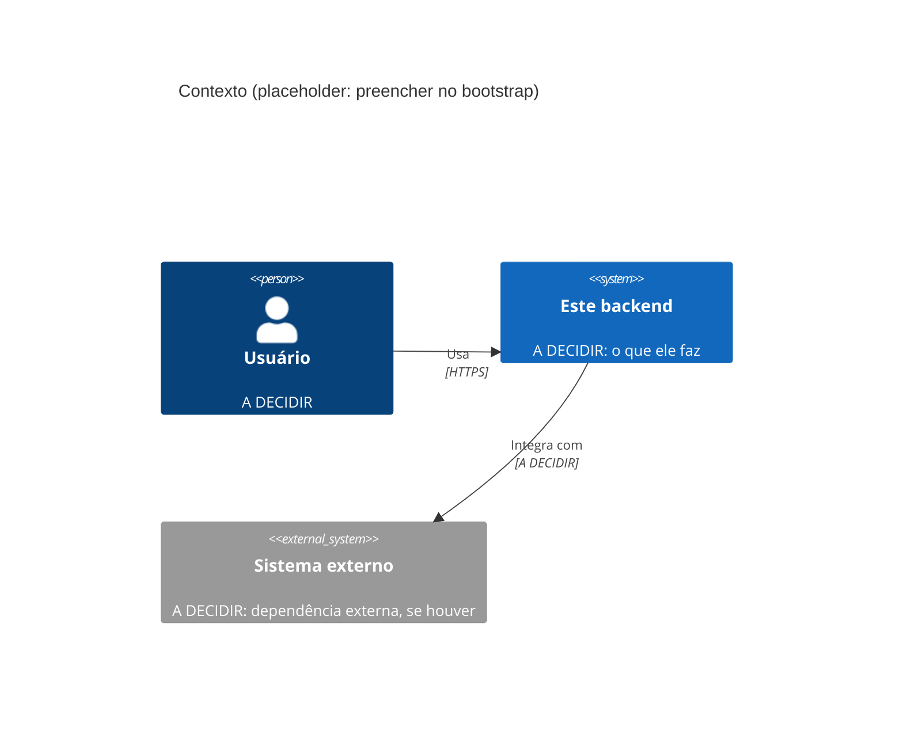
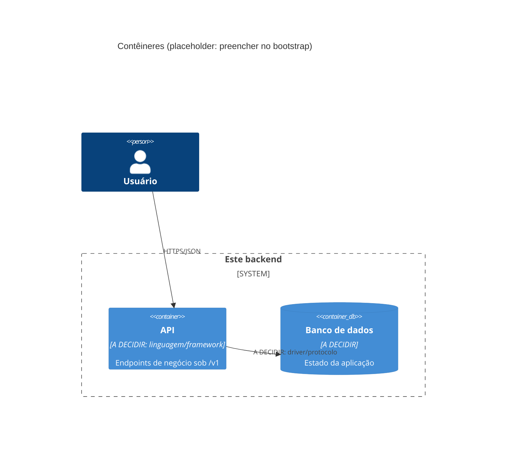
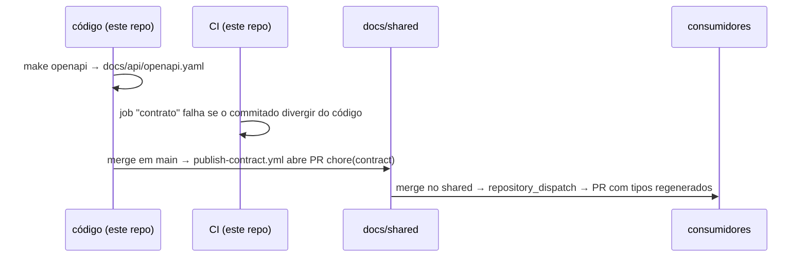
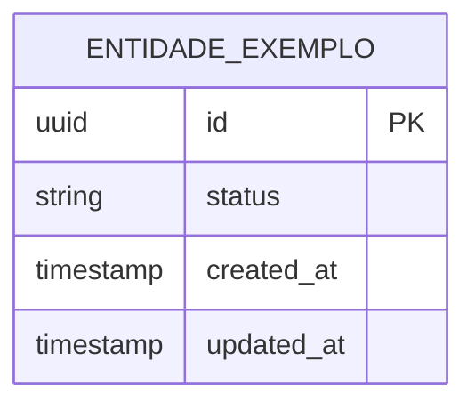

# Arquitetura

> **Esqueleto do template.** Preenchido pelo [`BOOTSTRAP.md`](BOOTSTRAP.md).
> O que depende de decisão do projeto está marcado como `A DECIDIR` ou com
> `<!-- -->`. Um agente de IA deve tratar um `A DECIDIR` remanescente como
> sinal de que a decisão ainda não foi tomada: **pergunte, não escolha**.
>
> Este documento cobre só **este repositório**. A visão de sistema (como os
> repositórios se conectam) e as decisões cross-repo ficam no docs/shared.

**Última revisão:** <!-- AAAA-MM-DD --> · **Responsável:** <!-- time/pessoa -->

---

## 1. Visão geral

<!--
Em até 10 linhas: o que este serviço faz, quem consome a API, com quem ele
conversa, o que NÃO faz. Volume esperado e SLA (BOOTSTRAP etapa 2).
-->

`A DECIDIR`

## 2. Diagramas C4

## 3. Camadas

<!-- Padrão escolhido (hexagonal, camadas, MVC) e o que mora em cada camada.
     Regra de dependência: domínio não conhece infraestrutura. Transforme em
     regra de lint/arquitetura quando a stack permitir. -->

| Camada | Responsabilidade | Pode depender de |
| --- | --- | --- |
| **API (entrada)** | HTTP, validação de entrada, serialização | Aplicação |
| **Aplicação** | Casos de uso, transações, orquestração | Domínio |
| **Domínio** | Regras de negócio, sem I/O | — |
| **Infraestrutura** | Banco, filas, APIs externas | Domínio (implementa as portas) |

**Fluxo de uma requisição típica:** <!-- do cliente à persistência e de volta -->

## 4. Contrato de API

O contrato nasce **do código** (code-first) e é distribuído pelo docs/shared:

- Endpoints de negócio nascem sob **`/v1/`**. Uma versão nova (`/v2/`) só
  com mudança incompatível que não pode ser feita de forma aditiva.
- `GET /health` e `GET /ready` ficam **fora da versão e sem autenticação**:
  são contrato de infraestrutura.
- **Formato de erro:** <!-- ex.: RFC 9457 (application/problem+json) -->
- **Paginação:** <!-- cursor ou offset; parâmetros e limites -->
- Ferramenta de geração: ver [`STACK.md`](STACK.md).
- docs/shared do projeto: <!-- org/repo, ou "não há" -->

## 5. Banco de dados

Regras de ORM, migrations e seeds em [`docs/database.md`](docs/database.md).

> Placeholder: substituir pelas entidades reais assim que houver migrations.

### Banco compartilhado

<!-- Se algum outro serviço lê ou escreve aqui, liste quem, quais tabelas,
     com que permissão. As migrations dessas tabelas continuam SÓ aqui. -->

| Serviço | Tabelas | Leitura/escrita | Usuário/role |
| --- | --- | --- | --- |
| <!-- --> | <!-- --> | <!-- --> | <!-- --> |

## 6. Autenticação e autorização

**Status: A DECIDIR** (BOOTSTRAP etapa 7).

<!--
  - Quem autentica: este serviço ou um identity provider/gateway
  - Sessão: JWT stateless ou sessão em banco/Redis; onde fica o refresh token
  - Modelo de permissão: RBAC ou ABAC; onde a autorização é verificada
  - Entre serviços: token repassado, token de serviço, mTLS
  - Decisão cross-repo? então é ADR no docs/shared, referenciado aqui
-->

## 7. Gestão de secrets em produção

**Status: A DECIDIR** (BOOTSTRAP etapa 8).

<!-- Onde vivem (Environment secrets, cofre), quem acessa, como rotaciona,
     como chegam ao processo em runtime. -->

## 8. Observabilidade

| Sinal | Padrão |
| --- | --- |
| Liveness | `GET /health`: o processo está de pé |
| Readiness | `GET /ready`: dependências (banco etc.) ok; 503 caso contrário |
| Logs | JSON, uma linha por evento, nível por `LOG_LEVEL` |
| Métricas | `/metrics`, formato Prometheus |
| Tracing | OpenTelemetry; `trace_id` recebido/propagado em headers (W3C `traceparent`) |

Campos mínimos de log: `timestamp`, `level`, `service`, `trace_id`,
`message`, `context`. Nunca segredo, token ou PII.

<!-- Onde é coletado e visualizado (Grafana, Datadog, nuvem). -->

## 9. Decisões arquiteturais

<!-- Uma linha por decisão. Se precisar de mais de um parágrafo, escreva um
     ADR em docs/adr/ e aponte para ele. Decisão que afeta mais de um
     repositório vai para o docs/adr/ do docs/shared. -->

| Data | Decisão | Motivo | Alternativa descartada |
| --- | --- | --- | --- |
| <!-- --> | <!-- --> | <!-- --> | <!-- --> |
