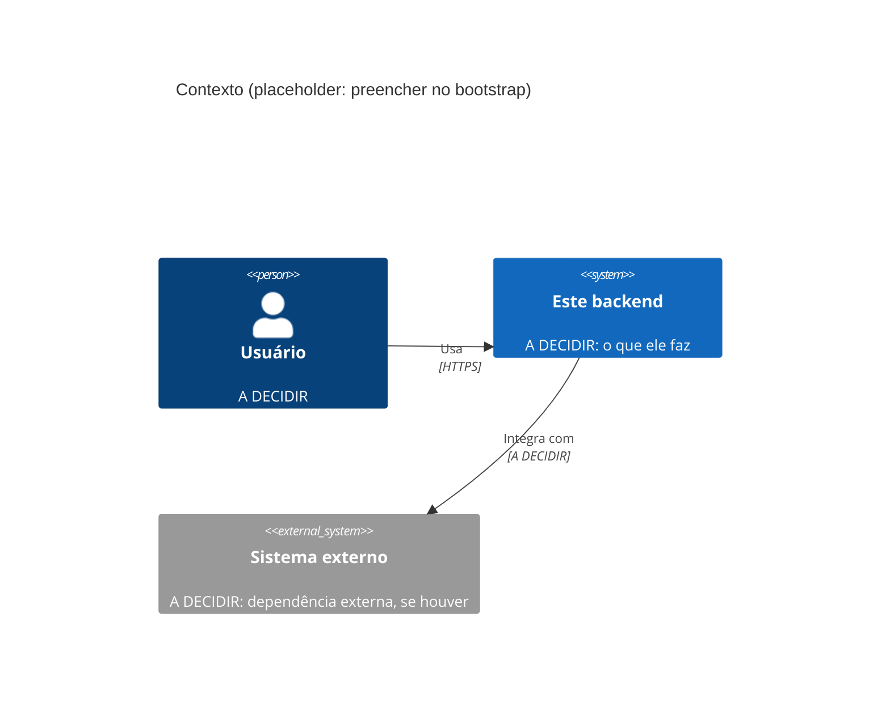
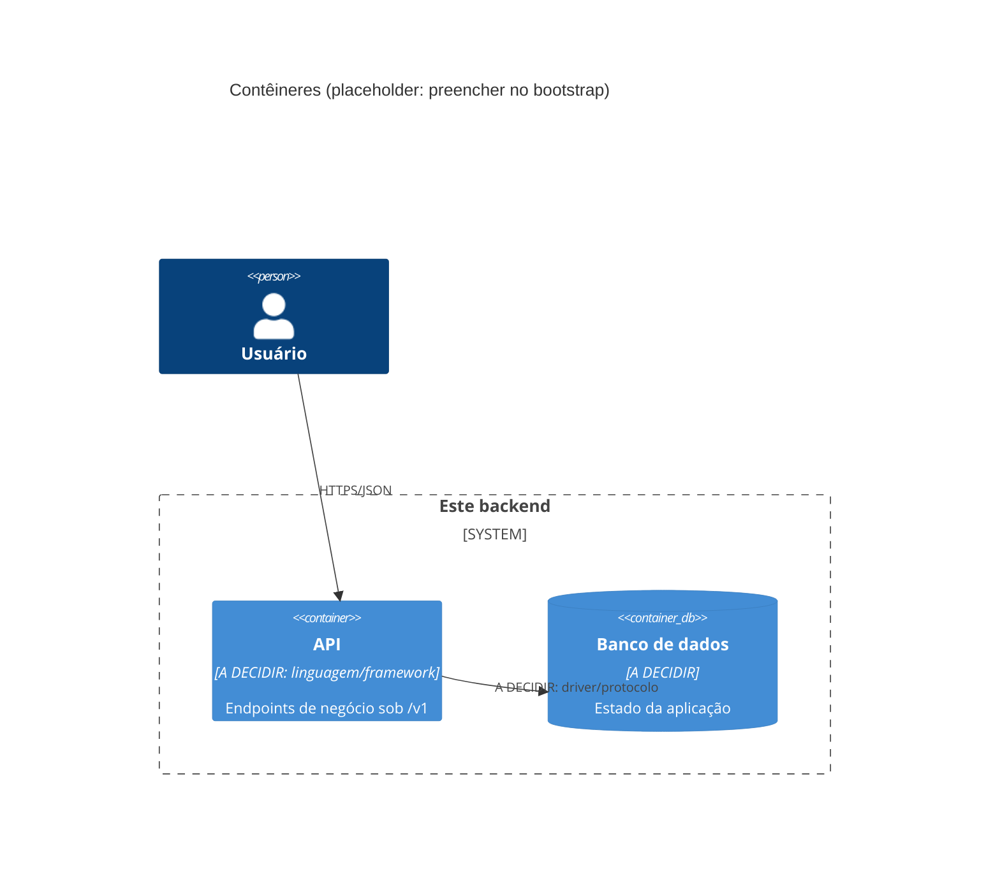
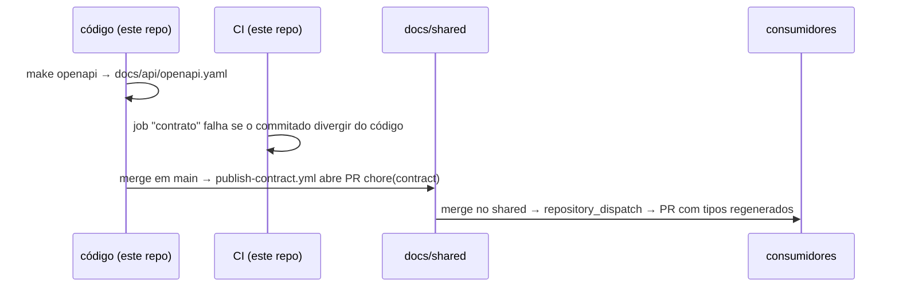
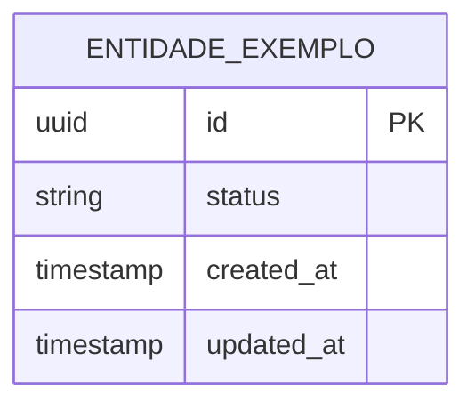

# Arquitetura

> **Esqueleto do template.** Preenchido pelo [`BOOTSTRAP.md`](BOOTSTRAP.md).
> O que depende de decisão do projeto está marcado como `A DECIDIR` ou com
> `<!-- -->`. Um agente de IA deve tratar um `A DECIDIR` remanescente como
> sinal de que a decisão ainda não foi tomada: **pergunte, não escolha**.
>
> Este documento cobre só **este repositório**. A visão de sistema (como os
> repositórios se conectam) e as decisões cross-repo ficam no docs/shared.

**Última revisão:** <!-- AAAA-MM-DD --> · **Responsável:** <!-- time/pessoa -->

---

## 1. Visão geral

<!--
Em até 10 linhas: o que este serviço faz, quem consome a API, com quem ele
conversa, o que NÃO faz. Volume esperado e SLA (BOOTSTRAP etapa 2).
-->

`A DECIDIR`

## 2. Diagramas C4

## 3. Camadas

<!-- Padrão escolhido (hexagonal, camadas, MVC) e o que mora em cada camada.
     Regra de dependência: domínio não conhece infraestrutura. Transforme em
     regra de lint/arquitetura quando a stack permitir. -->

| Camada | Responsabilidade | Pode depender de |
| --- | --- | --- |
| **API (entrada)** | HTTP, validação de entrada, serialização | Aplicação |
| **Aplicação** | Casos de uso, transações, orquestração | Domínio |
| **Domínio** | Regras de negócio, sem I/O | — |
| **Infraestrutura** | Banco, filas, APIs externas | Domínio (implementa as portas) |

**Fluxo de uma requisição típica:** <!-- do cliente à persistência e de volta -->

## 4. Contrato de API

O contrato nasce **do código** (code-first) e é distribuído pelo docs/shared:

- Endpoints de negócio nascem sob **`/v1/`**. Uma versão nova (`/v2/`) só
  com mudança incompatível que não pode ser feita de forma aditiva.
- `GET /health` e `GET /ready` ficam **fora da versão e sem autenticação**:
  são contrato de infraestrutura.
- **Formato de erro:** RFC 9457 (`application/problem+json`), com um campo
  extra `code` para o código de erro de negócio.
- **Paginação:** por cursor. Parâmetros `cursor` e `limit` (limite máximo a
  definir no primeiro endpoint de lista); a resposta devolve `next_cursor`.
- **Rotas (PROPOSTA, confirmar):** o doc 02 mistura o header `x-store-id`
  (§4.1) com `/api/stores/:storeId/...` (§4.4). Proposta: usar só o header
  `x-store-id`, para todas as rotas de negócio terem a mesma forma (seção 6),
  sob `/v1/` e sem o prefixo `/api`.
- Ferramenta de geração: `@fastify/swagger` (ver [`STACK.md`](STACK.md)).
  `OPENAPI_CMD` em `project.mk` **ainda não está configurado**: depende do
  scaffold do projeto (Etapa 1 do backlog).
- docs/shared do projeto: `Project-PKA/shared`. Falta configurar a variable
  `CONTRACT_REPO=Project-PKA/shared` e o `AUTOMATION_TOKEN` (ver
  [`docs/secrets.md`](docs/secrets.md)).

## 5. Banco de dados

Regras de ORM, migrations e seeds em [`docs/database.md`](docs/database.md).

> Placeholder: substituir pelas entidades reais assim que houver migrations.

### Banco compartilhado

<!-- Se algum outro serviço lê ou escreve aqui, liste quem, quais tabelas,
     com que permissão. As migrations dessas tabelas continuam SÓ aqui. -->

| Serviço | Tabelas | Leitura/escrita | Usuário/role |
| --- | --- | --- | --- |
| `whatsapp_microservice` | `stores`, `customers`, `cards_inventory`, `auctions`, `bids` (campos exatos a detalhar com o schema) | Leitura e escrita só onde o fluxo do bot exige | Role própria, a criar na migration inicial |

Referência: [ADR 0007](https://github.com/Project-PKA/shared/blob/main/docs/adr/0007-banco-compartilhado-e-sessao-whatsapp-por-qr-code.md).
`tcgdex_catalog` é global (sem `store_id`), exceção consciente à regra de
filtrar por loja ([ADR 0009](https://github.com/Project-PKA/shared/blob/main/docs/adr/0009-postgresql-hibrido-e-sync-do-tcgdex.md)).

## 6. Autenticação e autorização

**Status: decidido** (cross-repo: [ADR 0008](https://github.com/Project-PKA/shared/blob/main/docs/adr/0008-autenticacao-passwordless-e-multi-tenant.md)).

- **Quem autentica:** este serviço, sem identity provider externo.
- **Login:** e-mail + OTP numérico por e-mail. O OTP é guardado como hash,
  com expiração curta e limite de tentativas. Provedor de e-mail: A DECIDIR.
- **Sessão:** access JWT de vida curta no header `Authorization`, mais refresh
  token em cookie `httpOnly`. O refresh é rotacionado a cada uso e guardado
  como hash no banco, para permitir revogar a sessão.
- **Autorização:** RBAC por loja (`store_members`: `OWNER` ou `STAFF`, com
  `permissions` em JSONB). Toda rota autenticada, exceto a de seleção de
  loja, exige `x-store-id`; o middleware valida o acesso e toda query de
  negócio filtra por `store_id`.
- **Entre serviços:** não há chamada HTTP entre Backend e microservice por
  enquanto; ambos usam o banco, cada um com sua role. Se surgir chamada
  direta, vira ADR.
- **Mudança aqui exige aprovação humana** (`AGENTS.md`, seção 6).

## 7. Gestão de secrets em produção

**Status: decidido** (BOOTSTRAP etapa 8).

- **Onde vivem:** Secrets e Variables do **GitHub Environment** (`dev`,
  `homolog`, `prod`), injetados no deploy via SSH. Sem cofre externo.
- **Quem acessa:** quem tem permissão de admin no repositório. `homolog` e
  `prod` exigem aprovação para o deploy.
- **Rotação:** manual. Trocar o valor no Environment e refazer o deploy.
  `WHATSAPP_SESSION_ENCRYPTION_KEY` é exceção: trocar invalida as sessões
  salvas, então exige plano de migração.
- **Lista de nomes e como gerar cada um:** [`docs/secrets.md`](docs/secrets.md).
  Quem cria os secrets é a pessoa responsável, nunca o agente.
- **Local:** valores em `.env.secrets.local` (ignorado pelo git).

## 8. Observabilidade

| Sinal | Padrão |
| --- | --- |
| Liveness | `GET /health`: o processo está de pé |
| Readiness | `GET /ready`: dependências (banco etc.) ok; 503 caso contrário |
| Logs | JSON, uma linha por evento, nível por `LOG_LEVEL` |
| Métricas | `/metrics`, formato Prometheus |
| Tracing | OpenTelemetry; `trace_id` recebido/propagado em headers (W3C `traceparent`) |

Campos mínimos de log: `timestamp`, `level`, `service`, `trace_id`,
`message`, `context`. Nunca segredo, token ou PII.

Coleta e visualização: Prometheus e Grafana no mesmo `compose` da VPS
(ver `STACK.md`, seção 6).

## 9. Decisões arquiteturais

<!-- Uma linha por decisão. Se precisar de mais de um parágrafo, escreva um
     ADR em docs/adr/ e aponte para ele. Decisão que afeta mais de um
     repositório vai para o docs/adr/ do docs/shared. -->

| Data | Decisão | Motivo | Alternativa descartada |
| --- | --- | --- | --- |
| <!-- --> | <!-- --> | <!-- --> | <!-- --> |
