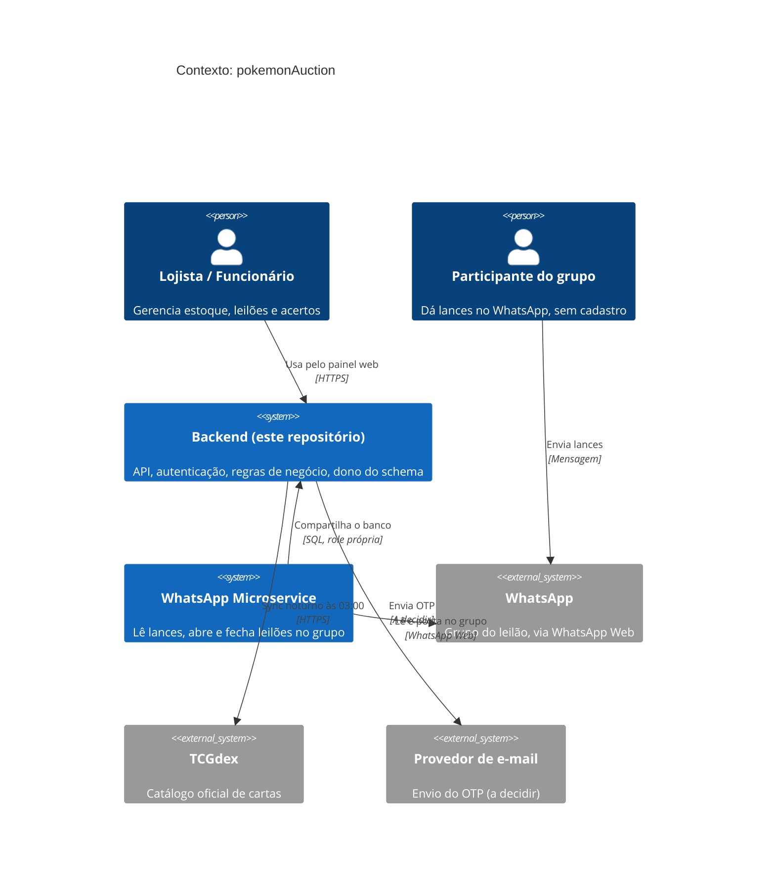
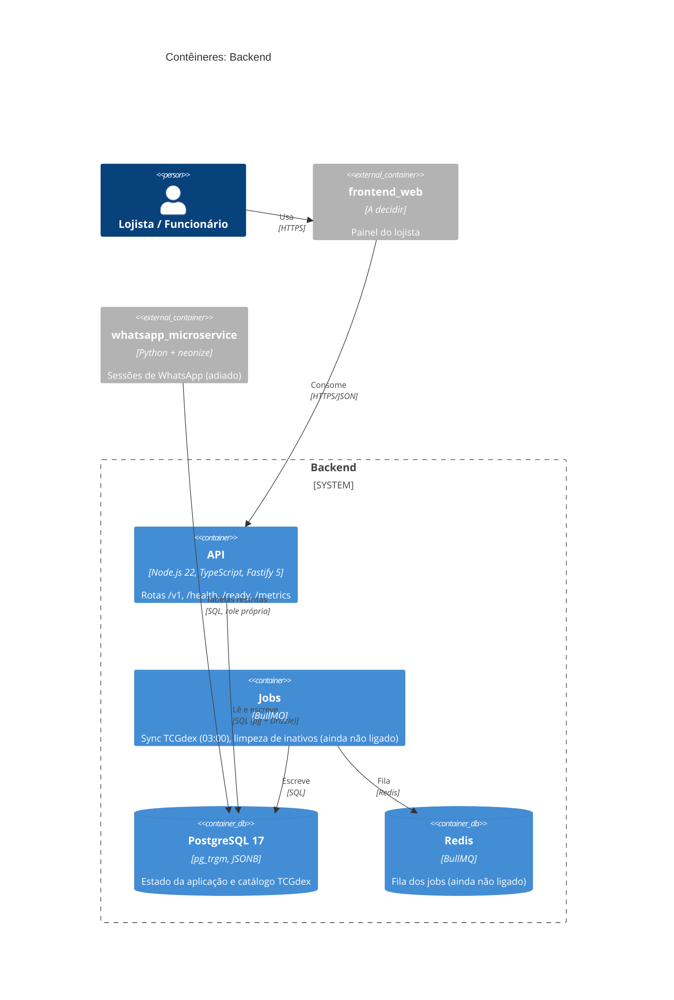
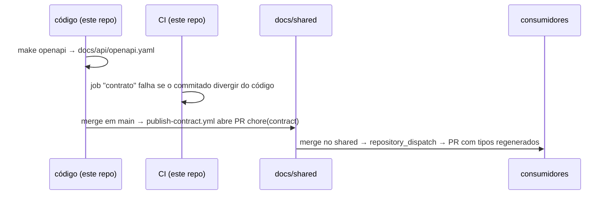
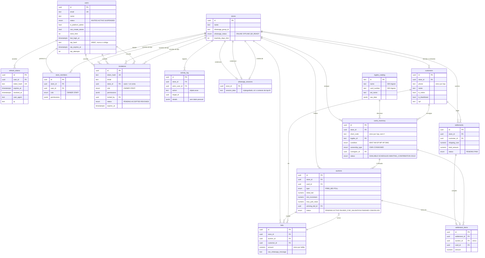

# Arquitetura

> Este documento cobre só **este repositório**. A visão de sistema (como os
> repositórios se conectam) e as decisões cross-repo ficam no
> [`Project-PKA/shared`](https://github.com/Project-PKA/shared).

**Última revisão:** 2026-10-17 · **Responsável:** dono do projeto

---

## 1. Visão geral

API do **pokemonAuction** (nome provisório), um SaaS B2B multi-tenant para
lojistas de Trading Card Games fazerem leilões de cartas em grupos de WhatsApp.

- **Quem consome:** o painel web do lojista (`frontend_web`). O bot de WhatsApp
  (`whatsapp_microservice`) **não** usa a API: acessa o banco com role própria.
- **O que faz:** login passwordless (e-mail + OTP), lojas e equipe com RBAC,
  estoque próprio e consignado, catálogo TCGdex local com autocomplete,
  clientes e visitantes, leilões, acertos pós-leilão e dashboards.
- **O que NÃO faz:** falar com o WhatsApp, processar pagamento, gerir envio
  (ADR 0002).
- **Estágio:** MVP, produto novo. Volume inicial pequeno (algumas lojas,
  centenas de mensagens por leilão). O que limita a escala não é a API e sim
  a RAM da VPS: cada loja conectada custa 150 a 300MB no bot (ADR 0010).
  Gatilho para revisitar: RAM da VPS como limite de lojas.
- **SLA:** nenhum contratado ainda.
- **Escopo ampliado pelo design (2026-10-17):** acesso somente por convite, área
  `/admin`, páginas públicas por link (vitrine, acerto, consignador), envios,
  planos, notificações e log de atividades. Veja
  [`https://github.com/Project-PKA/shared/blob/main/docs/produto.md`](https://github.com/Project-PKA/shared/blob/main/docs/produto.md) e o roteiro
  revisado em [`docs/roadmap.md`](docs/roadmap.md).

## 2. Diagramas C4





## 3. Camadas

Estrutura atual de `src/`:

```
src/
  config/env.ts      leitura e validação do ambiente (falha no boot)
  http/problem.ts    erros RFC 9457 e handlers globais
  routes/            rotas HTTP (infra hoje; /v1 a partir da Etapa 2)
  db/                client, schema (Drizzle), migrator, seed
  app.ts             monta o Fastify (logger, swagger, rotas)
  server.ts          ponto de entrada (porta, encerramento limpo)
```

À medida que as rotas de negócio entrarem, cada módulo (`auth`, `stores`,
`inventory`, `customers`, `auctions`, `settlements`) segue as camadas abaixo.
A regra de dependência é de cima para baixo e não se inverte.

| Camada | Responsabilidade | Pode depender de |
| --- | --- | --- |
| **Rotas** | HTTP, schema de entrada e saída, autenticação, `x-store-id` | Serviços |
| **Serviços** | Casos de uso, transações, regra de negócio (ex.: validar um lance) | Repositórios |
| **Repositórios** | Queries Drizzle, **sempre** filtradas por `store_id` | Banco |
| **Banco** | Schema, constraints e FKs compostas como última barreira | — |

**Fluxo de uma requisição de negócio:** cliente → `/v1/...` com
`Authorization` e `x-store-id` → autenticação (JWT) → middleware confere
`store_members` → rota valida o schema → serviço aplica a regra dentro de uma
transação → repositório consulta com `store_id` → resposta serializada pelo
schema de saída, ou erro `problem+json`.

## 4. Contrato de API

O contrato nasce **do código** (code-first) e é distribuído pelo docs/shared:



- Endpoints de negócio nascem sob **`/v1/`**. Uma versão nova (`/v2/`) só
  com mudança incompatível que não pode ser feita de forma aditiva.
- `GET /health` e `GET /ready` ficam **fora da versão e sem autenticação**:
  são contrato de infraestrutura.
- **Formato de erro:** RFC 9457 (`application/problem+json`), com um campo
  extra `code` para o código de erro de negócio.
- **Paginação:** por cursor. Parâmetros `cursor` e `limit` (limite máximo a
  definir no primeiro endpoint de lista); a resposta devolve `next_cursor`.
- **Rotas (decidido em 2026-10-17):** o doc 02 misturava o header
  `x-store-id` (§4.1) com `/api/stores/:storeId/...` (§4.4). Vale só o header
  `x-store-id`, para todas as rotas de negócio terem a mesma forma (seção 6),
  sob `/v1/` e sem o prefixo `/api`. Ex.: `GET /v1/dashboard/operational?period=7`.
- **Áreas de rotas** (todas sob `/v1`, exceto infraestrutura):
  `/v1/auth` (login, refresh, logout, aceitar convite), `/v1/me` (perfil e
  sessões), `POST /v1/stores` (criar loja), e as rotas de uma loja (exigem
  `x-store-id`): `/v1/store`, `/v1/team*`, `/v1/activity-log`, `/v1/catalog*` (busca e detalhe do catálogo) e `/v1/cards*` (estoque) e `/v1/auctions*` (leilões e lances),
  `/v1/admin` (só administrador da plataforma) e `/v1/public` (sem login,
  por token no link; vitrine, acerto, consignador, solicitação de acesso).
- Ferramenta de geração: `@fastify/swagger` (ver [`STACK.md`](STACK.md)).
  `make openapi` roda `scripts/openapi.ts`, que monta o app sem banco e grava
  `docs/api/openapi.yaml`.
- docs/shared do projeto: `Project-PKA/shared`. Falta configurar a variable
  `CONTRACT_REPO=Project-PKA/shared` e o `AUTOMATION_TOKEN` (ver
  [`docs/secrets.md`](docs/secrets.md)).

## 5. Banco de dados

Regras de ORM, migrations e seeds em [`docs/database.md`](docs/database.md).



Integridade que o banco garante (além das FKs): FK composta `(id, store_id)`
entre lojas, uma carta com no máximo um leilão em andamento, enquete com teto
acima do lance inicial, carta consignada com dono e comissão, acerto `PAID`
com data de pagamento e dois lances do mesmo valor no mesmo leilão não
coexistem. Detalhes nas migrations `0002` a `0007`.

### Banco compartilhado

<!-- Se algum outro serviço lê ou escreve aqui, liste quem, quais tabelas,
     com que permissão. As migrations dessas tabelas continuam SÓ aqui. -->

| Serviço | Tabelas | Leitura/escrita | Usuário/role |
| --- | --- | --- | --- |
| `whatsapp_microservice` | `stores`, `customers`, `cards_inventory`, `auctions`, `bids` (campos exatos a detalhar com o schema) | Leitura e escrita só onde o fluxo do bot exige | Role própria, a criar na migration inicial |

Referência: [ADR 0007](https://github.com/Project-PKA/shared/blob/main/docs/adr/0007-banco-compartilhado-e-sessao-whatsapp-por-qr-code.md).
`tcgdex_catalog` é global (sem `store_id`), exceção consciente à regra de
filtrar por loja ([ADR 0009](https://github.com/Project-PKA/shared/blob/main/docs/adr/0009-postgresql-hibrido-e-sync-do-tcgdex.md)).

## 6. Autenticação e autorização

**Status: decidido** (cross-repo: [ADR 0008](https://github.com/Project-PKA/shared/blob/main/docs/adr/0008-autenticacao-passwordless-e-multi-tenant.md)).

- **Quem autentica:** este serviço, sem identity provider externo.
- **Acesso por convite** ([ADR 0012](https://github.com/Project-PKA/shared/blob/main/docs/adr/0012-acesso-somente-por-convite-e-administracao-da-plataforma.md)):
  não há cadastro aberto. O pedido de OTP para e-mail sem conta devolve a
  mesma resposta e não envia código nem cria usuário. Usuário tem estado
  (`INVITED`, `ACTIVE`, `SUSPENDED`); suspender impede o login e revoga as
  sessões. Criar loja exige a permissão global `can_create_stores`, dentro
  do `store_limit`.
- **Login:** e-mail + OTP numérico por e-mail. O OTP é guardado como hash,
  com expiração curta e limite de tentativas. Provedor de e-mail: A DECIDIR.
- **Sessão:** access JWT de vida curta no header `Authorization`, mais refresh
  token em cookie `httpOnly`. O refresh é rotacionado a cada uso e guardado
  como hash no banco, para permitir revogar a sessão.
- **Autorização:** RBAC por loja (`store_members`: `OWNER` ou `STAFF`, com
  `permissions` em JSONB). Toda rota autenticada, exceto a de seleção de
  loja, exige `x-store-id`; o middleware valida o acesso e toda query de
  negócio filtra por `store_id`.
- **Entre serviços:** não há chamada HTTP entre Backend e microservice por
  enquanto; ambos usam o banco, cada um com sua role. Se surgir chamada
  direta, vira ADR.
- **Implementação** (`src/auth/`, `src/db/context.ts`): `AuthService` (OTP, JWT,
  refresh, sessões), `InvitationService` (criar, mostrar, aceitar), hooks
  `authenticate`, `requireStore`, `requirePermission`, `requireOwner` e
  `requirePlatformAdmin`. As rotas usam `preValidation`, então quem não está
  autenticado recebe 401 antes de qualquer erro de formato. O e-mail passa pela
  interface `EmailSender`; o provedor real ainda não foi escolhido.
- **Papéis do banco:** `owner` (migrations, seed e `db:create-admin`, com
  `BYPASSRLS`) usa `MIGRATION_DATABASE_URL`; a API em execução usa
  `DATABASE_URL`, o papel `app_api` do grupo `app_runtime`, **sem** `BYPASSRLS`.
  `users`, `refresh_tokens` e `invitations` ficam fora do RLS (o login e o
  convite acontecem antes de haver loja no contexto) e são protegidas por
  código e teste.
- **Implementação** (`src/auth/`, `src/db/context.ts`): `AuthService` (OTP, JWT,
  refresh, sessões), `InvitationService` (criar, mostrar, aceitar), hooks
  `authenticate`, `requireStore`, `requirePermission`, `requireOwner` e
  `requirePlatformAdmin`. As rotas usam `preValidation`, então quem não está
  autenticado recebe 401 antes de qualquer erro de formato. O e-mail passa pela
  interface `EmailSender`; o provedor real ainda não foi escolhido.
- **Papéis do banco:** `owner` (migrations, seed e `db:create-admin`, com
  `BYPASSRLS`) usa `MIGRATION_DATABASE_URL`; a API em execução usa
  `DATABASE_URL`, o papel `app_api` do grupo `app_runtime`, **sem** `BYPASSRLS`.
  `users`, `refresh_tokens` e `invitations` ficam fora do RLS (o login e o
  convite acontecem antes de haver loja no contexto) e são protegidas por
  código e teste.
- **Implementação** (`src/auth/`, `src/db/context.ts`): `AuthService` (OTP, JWT,
  refresh, sessões), `InvitationService` (criar, mostrar, aceitar), hooks
  `authenticate`, `requireStore`, `requirePermission`, `requireOwner` e
  `requirePlatformAdmin`. As rotas usam `preValidation`, então quem não está
  autenticado recebe 401 antes de qualquer erro de formato. O e-mail passa pela
  interface `EmailSender`; o provedor real ainda não foi escolhido.
- **Papéis do banco:** `owner` (migrations, seed e `db:create-admin`, com
  `BYPASSRLS`) usa `MIGRATION_DATABASE_URL`; a API em execução usa
  `DATABASE_URL`, o papel `app_api` do grupo `app_runtime`, **sem** `BYPASSRLS`.
  `users`, `refresh_tokens` e `invitations` ficam fora do RLS (o login e o
  convite acontecem antes de haver loja no contexto) e são protegidas por
  código e teste.
- **Segunda barreira: Row-Level Security** ([ADR 0011](https://github.com/Project-PKA/shared/blob/main/docs/adr/0011-row-level-security-como-segunda-barreira.md)),
  entregue na Etapa 2. Toda query de negócio roda em transação que define
  `app.store_id` (e `app.user_id` no login) com `set_config(..., true)`; sem
  contexto o banco devolve zero linhas. As tabelas de loja usam `FORCE ROW
  LEVEL SECURITY`, e o Backend conecta com o papel `app_runtime` (sem
  `BYPASSRLS`, sem `SUPERUSER`); migrations e seed usam o papel `owner`. O
  filtro por `store_id` no código **continua obrigatório**.
- **Administrador da plataforma:** marca `is_platform_admin`, concedida só por
  comando de linha (`db:create-admin`), nunca por API. As políticas de RLS dão
  a esse papel leitura de `stores` e `store_members` e criação de loja, e
  **nenhum acesso** a estoque, clientes, leilões, lances e acertos: a
  fronteira do administrador é garantida no banco, não só na rota.
- **Acesso público** (`/v1/public`): não usa sessão de usuário. Roda com um
  papel de banco próprio que só executa funções `SECURITY DEFINER`
  auditadas, que recebem o token do link e devolvem os campos permitidos
  ([ADR 0014](https://github.com/Project-PKA/shared/blob/main/docs/adr/0014-paginas-publicas-por-link-e-vitrine.md)).
- **Mudança aqui exige aprovação humana** (`AGENTS.md`, seção 6).

## 7. Gestão de secrets em produção

**Status: decidido** (BOOTSTRAP etapa 8).

- **Onde vivem:** Secrets e Variables do **GitHub Environment** (`dev`,
  `homolog`, `prod`), injetados no deploy via SSH. Sem cofre externo.
- **Quem acessa:** quem tem permissão de admin no repositório. `homolog` e
  `prod` exigem aprovação para o deploy.
- **Rotação:** manual. Trocar o valor no Environment e refazer o deploy.
  `WHATSAPP_SESSION_ENCRYPTION_KEY` é exceção: trocar invalida as sessões
  salvas, então exige plano de migração.
- **Lista de nomes e como gerar cada um:** [`docs/secrets.md`](docs/secrets.md).
  Quem cria os secrets é a pessoa responsável, nunca o agente.
- **Local:** valores em `.env.secrets.local` (ignorado pelo git).

## 8. Observabilidade

| Sinal | Padrão |
| --- | --- |
| Liveness | `GET /health`: o processo está de pé |
| Readiness | `GET /ready`: dependências (banco etc.) ok; 503 caso contrário |
| Logs | JSON, uma linha por evento, nível por `LOG_LEVEL` |
| Métricas | `/metrics`, formato Prometheus |
| Tracing | OpenTelemetry; `trace_id` recebido/propagado em headers (W3C `traceparent`) |

Campos mínimos de log: `timestamp`, `level`, `service`, `trace_id`,
`message`, `context`. Nunca segredo, token ou PII.

Coleta e visualização: Prometheus e Grafana no mesmo `compose` da VPS
(ver `STACK.md`, seção 6).

## 9. Decisões arquiteturais

<!-- Uma linha por decisão. Se precisar de mais de um parágrafo, escreva um
     ADR em docs/adr/ e aponte para ele. Decisão que afeta mais de um
     repositório vai para o docs/adr/ do docs/shared. -->

Decisões que afetam só este repositório. As que cruzam repositórios estão nas
ADRs do [`shared`](https://github.com/Project-PKA/shared/tree/main/docs/adr)
(0002 a 0010).

| Data | Decisão | Motivo | Alternativa descartada |
| --- | --- | --- | --- |
| 2026-10-17 | Fastify + `@fastify/swagger` | OpenAPI gerado do código, validação por schema | Express |
| 2026-10-17 | Drizzle com migrations SQL à mão (`up`/`down`) | Tipos do schema e SQL real para `pg_trgm`/GIN; regra do template exige `down` | Prisma (sem `down`) |
| 2026-10-17 | BullMQ + Redis para jobs | Retry e reexecução do sync do TCGdex | `node-cron` |
| 2026-10-17 | `short_code` sem `#` no banco | O `#` é só o prefixo da mensagem no grupo | Guardar com `#` |
| 2026-10-17 | Decisão de lance numa função do banco (`place_bid`) com trava da linha do leilão | Bot em Python e API em Node: a regra existe uma vez só, no dado ([ADR 0016](https://github.com/Project-PKA/shared/blob/main/docs/adr/0016-decisao-de-lance-em-funcao-do-banco.md)) | Mesma regra escrita em duas linguagens; trigger |
| 2026-10-17 | Acesso por convite e administrador da plataforma limitado pelo RLS | O adendo do design proíbe cadastro aberto; a fronteira do admin precisa valer no banco | Admin com acesso total às lojas |
| 2026-10-17 | Páginas públicas só por funções `SECURITY DEFINER` e token de alta entropia | Não afrouxar o RLS para o público; dado mínimo | Rotas públicas lendo as tabelas direto |
| 2026-10-17 | Link do consignador por consignador e loja, chave de 4 dígitos do CPF só como 2º fator | A chave sozinha tem 10 mil combinações | Chave de 4 dígitos como única proteção (desenho original) |
| 2026-10-17 | Log de atividades imutável, legível só pelo proprietário (a política confere o papel) e gravado na transação da ação | Auditoria que a aplicação não reescreve e que não some se a ação for desfeita | Log por middleware, fora da transação |
| 2026-10-17 | Limite de lojas conta lojas em que a pessoa é proprietária; criação trava a linha do usuário | Sem corrida; regra simples de explicar | Contar lojas criadas pela pessoa |
| 2026-10-17 | Row-Level Security como segunda barreira de isolamento | Esquecer um filtro por `store_id` deixa de vazar dado entre lojas | Só filtro no código e FK composta |
| 2026-10-17 | FK composta `(id, store_id)` entre tabelas de loja | Isolamento garantido pelo banco, não só pelo código | FK simples por `id` |
| 2026-10-17 | UUID, enums nativos e `numeric(12,2)` | Sem ID previsível, estados fechados no banco, dinheiro sem ponto flutuante | `serial`, texto livre, `float` |
| 2026-10-17 | OTP e refresh só em hash; tabelas `refresh_tokens` e `settlement_items` | Segurança (ADR 0008) e rastreio de acerto por carta | OTP em texto puro (doc 02 original) |
| 2026-10-17 | Rotas só com `x-store-id`, sob `/v1` | Uma forma única para as rotas de negócio | `/api/stores/:storeId/...` |
| 2026-10-17 | Erros em RFC 9457; paginação por cursor | Padrão aberto; estável com lances novos entrando | Formato próprio; offset |
