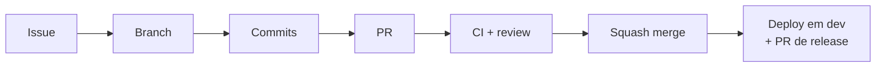

# Como contribuir

Este documento descreve o fluxo de trabalho. O contexto do projeto (o que
ele é, como se roda, o que exige aprovação humana) está no
[`AGENTS.md`](AGENTS.md), que vale para pessoas e para agentes de IA.

---

## Antes do primeiro commit

```bash
cp .env.example .env
make setup                 # instala dependências e ativa os hooks de git
docker compose up -d db    # banco local
make migrate && make seed  # schema e dados de desenvolvimento
make doctor                # confirma que o contrato está completo
```

**Windows:** `make` não vem instalado: `winget install ezwinports.make` ou
WSL. Os hooks e validadores rodam em `sh` e funcionam no Git Bash.

---

## Fluxo



Trunk-based: `main` é a única branch de longa duração. Branches de trabalho
vivem horas ou poucos dias.

### 1. Comece por uma issue

Toda mudança que não seja trivial nasce de uma issue. Ela é o lugar de
discutir **o quê** e **por quê**; o PR discute o **como**.

### 2. Crie a branch

```
<prefixo>/<slug-em-minusculas>
```

| Prefixo | Quando |
| --- | --- |
| `feature/` | Funcionalidade nova |
| `fix/` | Correção de bug |
| `hotfix/` | Correção urgente em produção |
| `release/` | Preparação manual de release (raro: o release-please cobre o normal) |
| `chore/` | Manutenção, dependências, infra |
| `docs/` | Só documentação |
| `refactor/` | Muda o código sem mudar comportamento |
| `test/` | Só testes |

O slug aceita `a-z`, `0-9`, `.`, `-` e `_`. Branches abertas por automação
(`dependabot/*`, `renovate/*`, `release-please--*`) são isentas.
Valide com `make check-branch`.

### 3. Faça commits em Conventional Commits

```
<tipo>(<escopo opcional>): <descrição no imperativo>
```

**Tipos:** `feat`, `fix`, `docs`, `style`, `refactor`, `perf`, `test`,
`build`, `ci`, `chore`, `revert`.

```
feat(estoque): adiciona cadastro de carta consignada
fix(auth): trata código OTP expirado como 401
feat(api)!: remove o campo legado de resposta
```

A descrição começa em minúscula e não termina com ponto, e o cabeçalho tem
no máximo 100 caracteres. Breaking change leva `!` e rodapé
`BREAKING CHANGE:`. Valide com `make check-commits`.

| Hook | O que faz |
| --- | --- |
| `pre-commit` | `make format-check` e `make lint` (pula os alvos ainda não configurados) |
| `commit-msg` | Valida a mensagem |
| `pre-push` | Valida o nome da branch e roda `make typecheck` |

Não use `--no-verify`: o CI aplica as mesmas regras.

### 4. Mudou o schema ou a API?

- **Schema:** `make migration NAME=...`, escreva `up.sql` **e** `down.sql`, e
  **atualize `src/db/schema.ts` e o seed no mesmo PR**
  ([`docs/database.md`](docs/database.md)). Mudança destrutiva segue
  expandir → contrair, em PRs separados.
- **API:** `make openapi` e commite `docs/api/openapi.yaml`. O CI falha se ele
  divergir do código. Mudança incompatível é `feat!:` e precisa de aprovação
  humana. Discuta antes na issue "Mudança de contrato de API" do
  [`shared`](https://github.com/Project-PKA/shared).

### 5. Antes de abrir o PR

```bash
make validate    # formato + lint + tipos + testes
make build
```

Checklist completo em [`AGENTS.md`, seção 5](AGENTS.md#5-checklist-de-conclusão-de-tarefa).

### 6. Abra o PR

- O título segue Conventional Commits, porque vira o commit em `main` e
  entra no CHANGELOG.
- Preencha o [template](.github/pull_request_template.md) inteiro, incluindo
  o checklist OWASP quando a mudança tocar autenticação, dado sensível ou
  entrada externa.
- Vincule a issue com `Closes #N`.
- PR pequeno.

### 7. Review e merge

| Automação | O que faz | Bloqueia? |
| --- | --- | --- |
| `CI` (`ci-success`) | Convenções, formato, lint, tipos, testes, build, contrato, imagem, SonarCloud | **Sim** |
| `CodeQL` | Análise de segurança | Configurável |
| `GitHub Agent` | Rotula, adiciona ao Project, comenta diagnóstico e cobertura | Não |
| `Release` | Mantém o PR de release com a próxima versão | Não |

**Squash merge**, sempre. Os requisitos são: `ci-success` verde, aprovação
de CODEOWNER e conversas resolvidas.

### 8. Release e deploy

Ninguém cria tag à mão. O release-please mantém aberto um PR
`chore(main): release X.Y.Z` (`fix` → patch, `feat` → minor, `!` → major).
O merge dele cria a tag e a GitHub Release, que dispara o deploy em `prod`
(com aprovação).

| Ambiente | Como dispara | Aprovação |
| --- | --- | --- |
| `dev` | Automático a cada push em `main` | Não |
| `test` | Manual (Actions → Deploy → Run workflow) | Não |
| `homolog` | Manual | **Sim** |
| `prod` | Release publicada, ou manual | **Sim** |

A mesma imagem (tag = SHA) percorre todos os ambientes. Detalhes em
[`DEPLOY.md`](DEPLOY.md).

---

## Reportando vulnerabilidade

Não abra issue pública. Veja [`SECURITY.md`](SECURITY.md).
