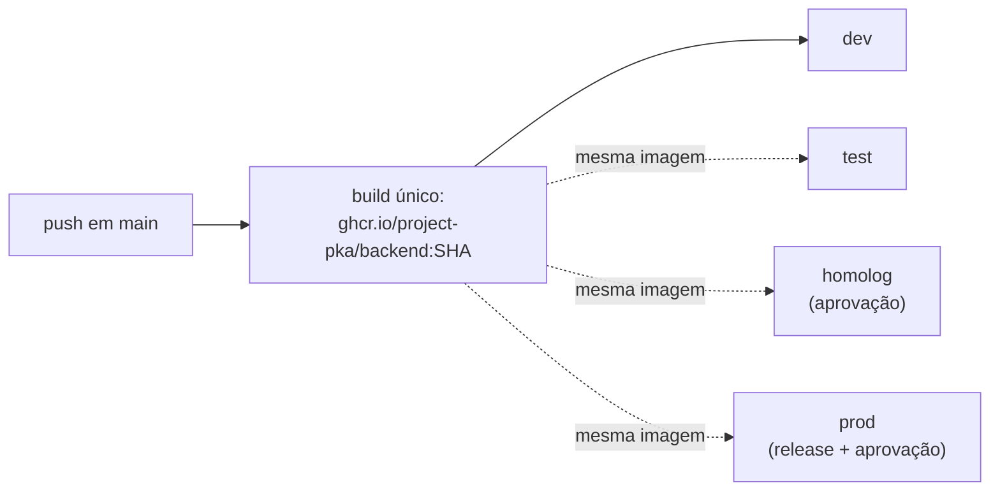

# Deploy

> **Status: não implementado.** A VPS ainda não foi contratada (decisão de
> 2026-10-17). O fluxo abaixo está **decidido**, mas `scripts/deploy.sh`, o
> `Dockerfile` e os Environments ainda não existem. Nada aqui foi testado em
> servidor real.

A fundação separa **como publicar**, que depende da plataforma, de **quando,
o quê e com que autorização publicar**, que não depende.

| Camada | Arquivo | Depende da plataforma? |
| --- | --- | --- |
| Gatilhos, ambientes, build único da imagem, smoke test | `.github/workflows/deploy.yml` | Não |
| Política de aprovação e secrets | GitHub Environments (interface) | Não |
| Implantação da imagem (e migrations) | `scripts/deploy.sh` | **Sim** (VPS via SSH) |

## Build once, deploy many



- A imagem é construída **uma vez**, no push em `main`, com tag = SHA do commit,
  e publicada no **GHCR** (login automático com o `GITHUB_TOKEN`).
- Promover é implantar **a mesma imagem** em outro ambiente.
- O que muda entre ambientes chega em **runtime**, pelas variables e secrets
  do Environment (`docs/secrets.md`). Nada de configuração gravada na imagem.
- **Rollback** é reimplantar o SHA anterior: **Actions → Deploy → Run
  workflow**, com o ambiente e o SHA.

## Ambientes

| Ambiente | Gatilho | Aprovação |
| --- | --- | --- |
| `dev` | Automático a cada push em `main` | Não |
| `test` | Manual (Actions → Deploy → Run workflow) | Não |
| `homolog` | Manual | **Sim** (required reviewers) |
| `prod` | Release publicada pelo release-please, ou manual | **Sim** (required reviewers) |

Configuração passo a passo em [`SETUP-GITHUB.md`](SETUP-GITHUB.md), seção B4.
No início, uma VPS só pode hospedar `dev` e `homolog` em portas ou domínios
diferentes; `prod` deve ter a sua. Decidir na contratação.

## O contrato de `scripts/deploy.sh`

| Variável | Origem | Sempre presente |
| --- | --- | --- |
| `DEPLOY_ENV` | Workflow | Sim (`dev`/`test`/`homolog`/`prod`) |
| `IMAGE` | Workflow | Sim (`ghcr.io/...:<sha>`, já publicada) |
| `APP_BASE_URL` | Variable do Environment | Se configurada |
| Demais | Secrets e variables repassados no `deploy.yml` | Conforme a receita |

**Saída:** `0` quando implantou; qualquer outro código falha o deploy.

**Migrations:** rodam **antes** da troca de versão, com **a mesma imagem** que
vai ser implantada, usando o runner do projeto (`node dist/db/cli.js up`, com
`MIGRATIONS_DIR` apontando para as migrations copiadas na imagem). Mudança
destrutiva segue expandir → contrair ([`docs/database.md`](docs/database.md)),
para a versão anterior continuar funcionando durante o rollout. O runner usa
lock consultivo, então dois deploys simultâneos não aplicam em dobro.

## Receita: VPS com docker compose (via SSH)

**Variables e secrets do Environment:** `SSH_HOST`, `SSH_USER`,
`SSH_PRIVATE_KEY`, `SSH_KNOWN_HOSTS`, `GHCR_PULL_TOKEN`, mais os da aplicação
(`docs/secrets.md`, seção 2).

```sh
# scripts/deploy.sh (a implementar quando a VPS existir)
: "${SSH_PRIVATE_KEY:?}" "${SSH_HOST:?}" "${SSH_USER:?}" "${SSH_KNOWN_HOSTS:?}"
key="$RUNNER_TEMP/deploy_key"
printf '%s\n' "$SSH_PRIVATE_KEY" > "$key" && chmod 600 "$key"
printf '%s\n' "$SSH_KNOWN_HOSTS" > "$RUNNER_TEMP/known_hosts"

ssh -i "$key" -o UserKnownHostsFile="$RUNNER_TEMP/known_hosts" -o StrictHostKeyChecking=yes \
  "$SSH_USER@$SSH_HOST" \
  "export IMAGE='$IMAGE' \
   && docker compose -f /srv/app/compose.yaml run --rm api node dist/db/cli.js up \
   && docker compose -f /srv/app/compose.yaml up -d api"
```

No servidor, o `compose.yaml` usa `image: ${IMAGE}` e um `.env` de produção
que **nunca** passa pelo repositório. O `compose.yaml` do repositório é só
para desenvolvimento local.

### Requisitos de segurança da VPS

Obrigatórios antes do primeiro deploy em `homolog` ou `prod` (lista completa em
[`SECURITY.md`](SECURITY.md)):

- Usuário de deploy **sem root**; SSH só por chave, sem senha; host key
  **fixada** em `SSH_KNOWN_HOSTS` (nada de `accept-new` em produção).
- Firewall aberto só para 80, 443 e SSH. **Postgres, Redis, Prometheus e
  Grafana sem porta pública.** O `compose.yaml` local publica a 5432; o de
  produção não.
- HTTPS por reverse proxy (a decidir: Caddy ou Nginx) com renovação automática
  de certificado. `/metrics` só na rede interna.
- O app conecta ao Postgres com usuário **sem** `SUPERUSER`. A credencial que
  roda migrations é separada e só existe durante o deploy.
- Backup do banco automático, criptografado e com **restauração testada**.

## Checklist ao implementar o deploy

- [ ] `Dockerfile` multi-stage que copia `dist/` e `migrations/` e roda como usuário não root
- [ ] `scripts/deploy.sh` implanta de verdade e falha com código diferente de 0 no erro
- [ ] Migrations rodam antes da troca de versão, com a mesma imagem
- [ ] Nenhum segredo no código nem em log (use secrets do Environment)
- [ ] Os quatro Environments existem, com aprovação em `homolog` e `prod`
- [ ] `APP_BASE_URL` configurada (sem ela o smoke test é pulado em silêncio)
- [ ] Rollback testado ao menos uma vez, antes de precisar dele
- [ ] O caminho de deploy é **único**: nenhuma integração automática publicando por fora e ignorando a aprovação
- [ ] Requisitos de segurança da VPS (acima) atendidos

## Rollback

| Ambiente | Como reverter | Quanto tempo leva |
| --- | --- | --- |
| `prod` | Actions → Deploy → Run workflow: `prod` + SHA anterior | A medir no primeiro teste |

**Migration já aplicada:** a versão anterior funciona com o schema novo porque
mudança destrutiva é feita em duas etapas (expandir → contrair). Se uma
migration mesmo assim precisar voltar, rode `node dist/db/cli.js down` com a
imagem **nova** (é ela que contém o `down.sql`) **antes** de implantar o SHA
anterior, e só em acordo com o responsável: `down` pode apagar dados.

**Quando reverter em vez de corrigir:** falha no smoke test, aumento de erro
5xx após o deploy, ou qualquer suspeita de vazamento entre lojas. Nesse último
caso, reverta primeiro e investigue depois.
