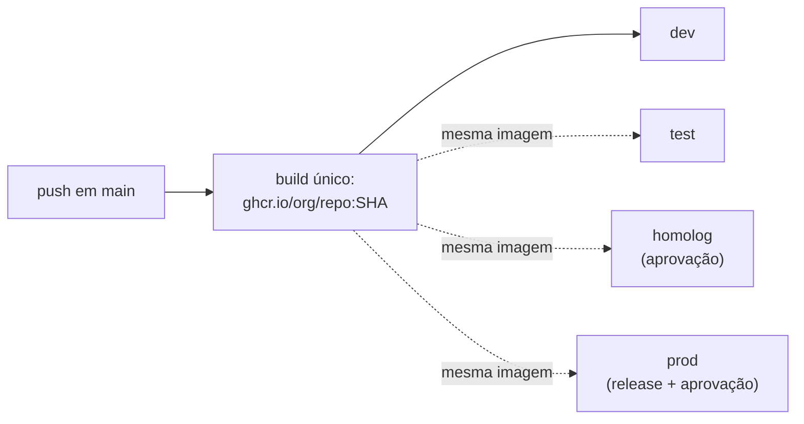

# Deploy

A fundação separa **como publicar**, que depende da plataforma, de **quando,
o quê e com que autorização publicar**, que não depende.

| Camada | Arquivo | Depende da plataforma? |
| --- | --- | --- |
| Gatilhos, ambientes, build único da imagem, smoke test | `.github/workflows/deploy.yml` | Não |
| Política de aprovação e secrets | GitHub Environments (interface) | Não |
| Implantação da imagem (e migrations) | `scripts/deploy.sh` | **Sim** |

Trocar de plataforma é reescrever **um** arquivo: `scripts/deploy.sh`.

---

## Build once, deploy many



- A imagem é construída **uma vez**, no push em `main`, com tag = SHA do commit.
- Promover é implantar **a mesma imagem** em outro ambiente. O workflow
  recusa promover um SHA que não tenha imagem, então não existe "build de
  produção" diferente do que foi testado.
- O que muda entre ambientes chega em **runtime**, pelas variables e secrets
  do Environment. Nada de configuração gravada na imagem.
- **Rollback** é reimplantar o SHA anterior: **Actions → Deploy → Run
  workflow**, com o ambiente e o SHA. Não precisa reverter merge.

## Registry da imagem

A variable `IMAGE_REPOSITORY` (do repositório ou da organização, **sem a
tag**) escolhe onde a imagem mora. Sem ela, é o GHCR. O `deploy.yml` detecta
o tipo e faz o login certo, tanto no build quanto na verificação do deploy.

| `IMAGE_REPOSITORY` | Registry | Login | Quando usar |
| --- | --- | --- | --- |
| (vazio) | `ghcr.io/<org>/<repo>` | Automático (`GITHUB_TOKEN`) | Kubernetes, VPS, Azure; ECS com credencial de pull |
| `<conta>.dkr.ecr.<região>.amazonaws.com/<nome>` | AWS ECR | OIDC: secret `AWS_ECR_ROLE_ARN` | AWS: **obrigatório para Lambda**, recomendado para ECS e App Runner |
| Outro (`docker.io/...`, `<região>-docker.pkg.dev/...`) | Docker Hub, Artifact Registry... | Variable `REGISTRY_USERNAME` + secret `REGISTRY_PASSWORD` | Padrão da organização, Cloud Run |

**Role do ECR (`AWS_ECR_ROLE_ARN`):** precisa de push/pull no repositório do
ECR. A trust policy aceita o job de build (sem Environment) **e** os jobs
de deploy (que verificam a imagem):

```json
"StringLike": {
  "token.actions.githubusercontent.com:sub": [
    "repo:SUA-ORG/SEU-REPOSITORIO:ref:refs/heads/main",
    "repo:SUA-ORG/SEU-REPOSITORIO:environment:*"
  ]
}
```

---

## Modelo de ambientes

| Ambiente | Gatilho | Aprovação |
| --- | --- | --- |
| `dev` | Automático a cada push em `main` | Não |
| `test` | Manual (Actions → Deploy → Run workflow) | Não |
| `homolog` | Manual | **Sim** (required reviewers) |
| `prod` | Release publicada pelo release-please, ou manual | **Sim** (required reviewers) |

A aprovação é *protection rule* do Environment, não `if:` no YAML.
Configuração passo a passo em [`SETUP-GITHUB.md`](SETUP-GITHUB.md), seção B4.

---

## O contrato de `scripts/deploy.sh`

**Entrada:**

| Variável | Origem | Sempre presente |
| --- | --- | --- |
| `DEPLOY_ENV` | Workflow | Sim (`dev`/`test`/`homolog`/`prod`) |
| `IMAGE` | Workflow | Sim (`ghcr.io/org/repo:<sha>`, já publicada) |
| `APP_BASE_URL` | Variable do Environment | Se configurada |
| Demais | Secrets e variables repassados no `deploy.yml` | Conforme a receita |

**Saída:** `0` quando implantou; qualquer outro código falha o deploy.

**Migrations:** rodam **antes** da troca de versão, com **a mesma imagem**
que vai ser implantada. Mudança destrutiva segue expandir → contrair
([`docs/database.md`](docs/database.md)), para a versão anterior continuar
funcionando durante o rollout.

---

## Receita: Kubernetes

**Environment:** `KUBE_CONFIG` (secret; ou OIDC da nuvem + `get-credentials`),
`KUBE_NAMESPACE` e `KUBE_DEPLOYMENT` (variables).

```sh
# scripts/deploy.sh (trecho a colocar no lugar do bloco PENDING)
: "${KUBE_CONFIG:?}" "${KUBE_NAMESPACE:?}" "${KUBE_DEPLOYMENT:?}"
printf '%s' "$KUBE_CONFIG" > "$RUNNER_TEMP/kubeconfig"
export KUBECONFIG="$RUNNER_TEMP/kubeconfig"

# 1. Migrations com a mesma imagem, como Job que precisa terminar com sucesso.
#    O comando e o de migrate que existe DENTRO da imagem (a imagem de
#    runtime nao tem make): ex. `alembic upgrade head`, `node dist/migrate.js`.
job="migrate-$(date +%s)"
kubectl -n "$KUBE_NAMESPACE" create job "$job" --image="$IMAGE" -- alembic upgrade head
kubectl -n "$KUBE_NAMESPACE" wait --for=condition=complete "job/$job" --timeout=5m

# 2. Troca de versão e espera o rollout.
kubectl -n "$KUBE_NAMESPACE" set image "deployment/$KUBE_DEPLOYMENT" app="$IMAGE"
kubectl -n "$KUBE_NAMESPACE" rollout status "deployment/$KUBE_DEPLOYMENT" --timeout=5m
```

Repasse `KUBE_CONFIG`, `KUBE_NAMESPACE` e `KUBE_DEPLOYMENT` no passo
`Publicar` do `deploy.yml`. Readiness e liveness probes apontam para
`/ready` e `/health`.

## Receita: Google Cloud Run

**Credenciais:** descomente o bloco `google-github-actions/auth` no
`deploy.yml` (OIDC). **Environment:** `CLOUD_RUN_SERVICE`, `GCP_REGION`.

> O Cloud Run não puxa imagens do GHCR diretamente. Copie a imagem para o
> Artifact Registry (`gcrane cp`/`docker tag` + `push`) ou use um repositório
> remoto do Artifact Registry apontando para o `ghcr.io`.

```sh
: "${CLOUD_RUN_SERVICE:?}" "${GCP_REGION:?}"
# Migrations: um Cloud Run Job com a mesma imagem, antes da troca de versao.
gcloud run jobs deploy "$CLOUD_RUN_SERVICE-migrate" --image "$IMAGE" --region "$GCP_REGION" \
  --command alembic --args upgrade,head --execute-now --wait --quiet
gcloud run deploy "$CLOUD_RUN_SERVICE" --image "$IMAGE" --region "$GCP_REGION" --quiet
```

## Receita: AWS ECS (Fargate)

**Credenciais:** bloco `aws-actions/configure-aws-credentials` (OIDC).
**Environment:** `ECS_CLUSTER`, `ECS_SERVICE`, `AWS_REGION`.

Gere uma nova *task definition* com a imagem (por exemplo, com
`aws-actions/amazon-ecs-render-task-definition` no workflow ou `jq` aqui),
rode as migrations como *task* avulsa (`aws ecs run-task` + `wait
tasks-stopped`) e atualize o serviço com `aws ecs update-service` +
`aws ecs wait services-stable`.

## Receita: AWS Lambda (imagem de container)

Lambda com container encaixa no build once, deploy many: a imagem é a mesma,
só muda a função de cada ambiente.

- **Registry:** a Lambda só aceita imagem do **ECR** da mesma região.
  Configure `IMAGE_REPOSITORY` para o ECR (seção "Registry da imagem").
- **Imagem:** precisa implementar a Runtime Interface da Lambda. Use as
  imagens base `public.ecr.aws/lambda/<linguagem>` no `Dockerfile` ou o
  *runtime interface client* da linguagem.
- **Credenciais:** bloco `aws-actions/configure-aws-credentials` no
  `deploy.yml` (OIDC), com o role do ambiente (`lambda:UpdateFunctionCode`
  e `lambda:GetFunction`).
- **Environment:** variable `LAMBDA_FUNCTION` (uma função por ambiente).

```sh
: "${LAMBDA_FUNCTION:?}"
aws lambda update-function-code --function-name "$LAMBDA_FUNCTION" --image-uri "$IMAGE" >/dev/null
aws lambda wait function-updated --function-name "$LAMBDA_FUNCTION"
```

Repasse `LAMBDA_FUNCTION` no passo `Publicar` do `deploy.yml`.

> **Lambda por zip** (sem container) fica fora deste modelo, porque não há
> imagem para promover. Se for indispensável, publique o zip por SHA num
> bucket S3 no push em `main` e promova o mesmo zip entre ambientes
> (adaptando o `deploy.yml`). A recomendação é usar container.

> **Migrations em Lambda:** não existe "job avulso". Use uma função
> `<nome>-migrate` com a mesma imagem e outro comando
> (`--image-config Command=...`), invocada antes do `update-function-code`,
> ou uma task ECS avulsa.

## Receita: VPS com docker compose (via SSH)

Para projeto pequeno, uma máquina só.

**Environment:** `SSH_PRIVATE_KEY` (secret), `SSH_HOST` e `SSH_USER`.

```sh
: "${SSH_PRIVATE_KEY:?}" "${SSH_HOST:?}" "${SSH_USER:?}"
key="$RUNNER_TEMP/deploy_key"
printf '%s\n' "$SSH_PRIVATE_KEY" > "$key" && chmod 600 "$key"
ssh -i "$key" -o StrictHostKeyChecking=accept-new "$SSH_USER@$SSH_HOST" \
  "IMAGE='$IMAGE' docker compose -f /srv/app/compose.yaml run --rm app alembic upgrade head \
   && IMAGE='$IMAGE' docker compose -f /srv/app/compose.yaml up -d app"
```

No servidor, o `compose.yaml` usa `image: ${IMAGE}` e um `.env` de produção
que **nunca** passa pelo repositório.

> Nas três receitas, `alembic upgrade head` é só o exemplo: troque pelo
> comando de migrate que existe **dentro** da imagem da sua stack.

---

## Checklist ao implementar o deploy

- [ ] `scripts/deploy.sh` implanta de verdade e falha com código diferente de 0 no erro
- [ ] Migrations rodam antes da troca de versão, com a mesma imagem
- [ ] Nenhum segredo no código nem em log (use secrets do Environment)
- [ ] Credencial de curta duração (OIDC) sempre que a plataforma suportar
- [ ] Os quatro Environments existem, com aprovação em `homolog` e `prod`
- [ ] `APP_BASE_URL` configurada (sem ela o smoke test é pulado em silêncio)
- [ ] Rollback testado ao menos uma vez, antes de precisar dele
- [ ] O caminho de deploy é **único**: nenhuma integração automática da
      plataforma publicando por fora e ignorando a aprovação

---

## Rollback

<!-- Preencha ao implementar o deploy. Quem estiver de plantão às 3h da manhã
     precisa achar isto em 30 segundos. -->

| Ambiente | Como reverter | Quanto tempo leva |
| --- | --- | --- |
| `prod` | Actions → Deploy → Run workflow: `prod` + SHA anterior | <!-- --> |

**Migration já aplicada:** <!-- a versão anterior funciona com o schema novo? (expandir → contrair garante que sim) -->

**Quando reverter em vez de corrigir:** <!-- critério do time -->
