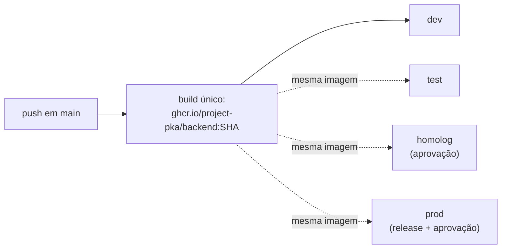

# Deploy

> **Status:** o fluxo está **implementado e testado localmente** (compose, migrations, papel da API,
> backup e restauração rodaram de ponta a ponta com a imagem real), mas **ainda não foi executado numa
> VPS**, porque ela não existe. O job de deploy do GitHub só roda com a variable `DEPLOY_ENABLED=true`.
> `homolog` e `prod` enviam e-mail por **SMTP do Gmail** (decisão D1; a troca por um provedor
> transacional está em `Project-PKA/shared`): a API recusa subir com o provedor `log` nesses
> ambientes. Preencha `SMTP_USER` e `EMAIL_PASSWORD` (senha de app do Google) no `.env` da VPS: o
> deploy não copia secrets do GitHub para lá.
>
> **Arquivos enviados** (fotos das cartas) ficam no volume `storage_data`, no disco da VPS (D3), e
> entram no `backup.sh` (`backups/<data>.storage.tar.enc`, criptografado como o dump).

A fundação separa **como publicar**, que depende da plataforma, de **quando,
o quê e com que autorização publicar**, que não depende.

| Camada | Arquivo | Depende da plataforma? |
| --- | --- | --- |
| Gatilhos, ambientes, build único da imagem, smoke test | `.github/workflows/deploy.yml` | Não |
| Política de aprovação e secrets | GitHub Environments (interface) | Não |
| Implantação da imagem (e migrations) | `scripts/deploy.sh` | **Sim** (VPS via SSH) |

## Build once, deploy many

- A imagem é construída **uma vez**, no push em `main`, com tag = SHA do commit,
  e publicada no **GHCR** (login automático com o `GITHUB_TOKEN`).
- Promover é implantar **a mesma imagem** em outro ambiente.
- O que muda entre ambientes chega em **runtime**, pelas variables e secrets
  do Environment (`docs/secrets.md`). Nada de configuração gravada na imagem.
- **Rollback** é reimplantar o SHA anterior: **Actions → Deploy → Run
  workflow**, com o ambiente e o SHA.

## Ambientes

| Ambiente | Gatilho | Aprovação |
| --- | --- | --- |
| `dev` | Automático a cada push em `main` | Não |
| `test` | Manual (Actions → Deploy → Run workflow) | Não |
| `homolog` | Manual | **Sim** (required reviewers) |
| `prod` | Release publicada pelo release-please, ou manual | **Sim** (required reviewers) |

Configuração passo a passo em [`SETUP-GITHUB.md`](SETUP-GITHUB.md), seção B4.
No início, uma VPS só pode hospedar `dev` e `homolog` em portas ou domínios
diferentes; `prod` deve ter a sua. Decidir na contratação.

## O contrato de `scripts/deploy.sh`

| Variável | Origem | Sempre presente |
| --- | --- | --- |
| `DEPLOY_ENV` | Workflow | Sim (`dev`/`test`/`homolog`/`prod`) |
| `IMAGE` | Workflow | Sim (`ghcr.io/...:<sha>`, já publicada) |
| `APP_BASE_URL` | Variable do Environment | Se configurada |
| Demais | Secrets e variables repassados no `deploy.yml` | Conforme a receita |

**Saída:** `0` quando implantou; qualquer outro código falha o deploy.

**Migrations:** rodam **antes** da troca de versão, com **a mesma imagem** que
vai ser implantada, usando o runner do projeto (`node dist/db/cli.js up`, com
`MIGRATIONS_DIR` apontando para as migrations copiadas na imagem). Mudança
destrutiva segue expandir → contrair ([`docs/database.md`](docs/database.md)),
para a versão anterior continuar funcionando durante o rollout. O runner usa
lock consultivo, então dois deploys simultâneos não aplicam em dobro.

## Receita: VPS com docker compose (via SSH)

Arquivos no repositório: [`scripts/deploy.sh`](scripts/deploy.sh) (o deploy),
[`deploy/compose.prod.yaml`](deploy/compose.prod.yaml) (API, Postgres, Redis e Caddy),
[`deploy/Caddyfile`](deploy/Caddyfile) (HTTPS automático), [`deploy/env.example`](deploy/env.example)
(modelo do `.env` da VPS), [`deploy/backup.sh`](deploy/backup.sh) e [`deploy/restore.sh`](deploy/restore.sh).

**O que cada deploy faz** (`scripts/deploy.sh`, por SSH, com o usuário sem root):

1. copia o `compose.prod.yaml` e o `Caddyfile` para `/srv/pokemon-auction/<ambiente>/`;
2. faz login no GHCR (o token vai pela entrada padrão, não em argumento) e puxa a imagem do SHA;
3. sobe `db` e `redis`;
4. roda as **migrations** com a mesma imagem e o papel dono (`node dist/db/cli.js up`);
5. cria ou atualiza o **papel de login da API** (`app_api`, sem `BYPASSRLS`) com a senha do `.env`
   (`node dist/db/provision-cli.js`, idempotente e sem imprimir a senha);
6. sobe a API e o Caddy e **espera `/ready`** (banco e Redis respondendo) antes de dar por feito.

A API **não recebe** a senha do dono do schema nem a do backup: o compose lista só as variáveis dela
(nada de `env_file`). Roda com sistema de arquivos somente leitura, sem capacidades Linux e sem
`new-privileges`. Só o Caddy publica porta (80 e 443); Postgres, Redis e a API ficam na rede interna, e
`/metrics` responde 404 pela internet.

### Preparar a VPS (uma vez por ambiente)

1. **Servidor:** Ubuntu LTS atualizado, Docker Engine com o plugin compose, `ufw` liberando só 22, 80 e
   443, e o SSH só por chave, sem root e sem senha.
2. **Usuário de deploy** (por exemplo `deploy`, sem sudo, no grupo `docker`) e a chave pública dele em
   `~/.ssh/authorized_keys`. A chave privada vira o secret `SSH_PRIVATE_KEY`; a impressão digital do
   servidor (`ssh-keyscan -t ed25519 <host>`) vira `SSH_KNOWN_HOSTS`.
3. **DNS:** um registro A do domínio da API (`APP_DOMAIN`) apontando para a VPS. O Caddy emite o
   certificado sozinho na primeira vez que o domínio resolver.
4. **Pasta e `.env`:** `sudo install -d -o deploy -g deploy /srv/pokemon-auction/dev`, copie
   `deploy/env.example` para lá como `.env`, preencha, `chmod 600 .env`. Senhas do banco e do Redis com
   `openssl rand -hex 32`; os demais segredos com `openssl rand -base64 48`.
5. **GitHub:** crie o Environment (`dev`, depois `homolog` e `prod` com aprovação) e cadastre
   `SSH_HOST`, `SSH_USER`, `GHCR_PULL_USER` (variables) e `SSH_PRIVATE_KEY`, `SSH_KNOWN_HOSTS`,
   `GHCR_PULL_TOKEN` (secrets; `docs/secrets.md`, seção 3). Por último, a variable de repositório
   `DEPLOY_ENABLED=true`.
6. **Primeiro deploy:** Actions → Deploy → Run workflow (ambiente `dev`). Confira `GET /health` e
   `/ready` no domínio.
7. **Primeiro administrador** (nunca por tela ou API), na VPS:
   `docker compose --env-file .env --env-file image.env run --rm -e MIGRATION_DATABASE_URL="postgresql://owner:<DB_OWNER_PASSWORD>@db:5432/app" api node dist/db/create-admin.js <email> "<Nome>"`
8. **Backup:** cole `deploy/backup.sh` e `deploy/restore.sh` na pasta do ambiente (ou deixe o deploy
   copiá-los) e agende:
   `17 3 * * *  cd /srv/pokemon-auction/prod && sh backup.sh >> backup.log 2>&1`.
   **Guarde a `BACKUP_PASSPHRASE` num gerenciador de senhas**: sem ela o backup não abre.
9. **Teste a restauração** antes de depender dela: `sh restore.sh backups/<arquivo>.dump.enc` restaura
   num banco descartável (`restore_check`), confere tabelas e usuários e apaga o banco de teste; com a `CPF_ENCRYPTION_KEY` no `.env`, confere que os CPFs do backup abrem com ela. A guarda e a rotação dessa chave estão em [`docs/secrets.md`](docs/secrets.md).

### Restaurar de verdade (desastre)

1. Pare a API: `docker compose --env-file .env --env-file image.env stop api`.
2. `sh restore.sh backups/<arquivo>.dump.enc --keep` e confira os números impressos.
3. Troque o banco: no `psql` do dono, `ALTER DATABASE app RENAME TO app_antigo;` e
   `ALTER DATABASE restore_check RENAME TO app;` (ou ajuste `DB_NAME`).
4. Rode o provisionamento de novo (ele recria os grants do papel da API) e suba a API.
5. Guarde o banco antigo até confirmar que está tudo certo.

### Requisitos de segurança da VPS

Obrigatórios antes do primeiro deploy em `homolog` ou `prod` (lista completa em
[`SECURITY.md`](SECURITY.md)):

- Usuário de deploy **sem root**; SSH só por chave, sem senha; host key
  **fixada** em `SSH_KNOWN_HOSTS` (nada de `accept-new` em produção).
- Firewall aberto só para 80, 443 e SSH. **Postgres, Redis, Prometheus e
  Grafana sem porta pública.** O `compose.yaml` local publica a 5432; o de
  produção não.
- HTTPS por reverse proxy (a decidir: Caddy ou Nginx) com renovação automática
  de certificado. `/metrics` só na rede interna.
- O app conecta ao Postgres como `app_api` (grupo `app_runtime`), **sem**
  `SUPERUSER` e **sem** `BYPASSRLS`: é isso que faz o RLS valer (ADR 0011). O
  dono do schema (`MIGRATION_DATABASE_URL`, com `BYPASSRLS`) roda migrations e
  `db:create-admin` e só existe durante o deploy. A criação do `app_api`, com
  a senha do secret, está em `docs/secrets.md`.
- O primeiro administrador da plataforma é criado na VPS com
  `node dist/db/create-admin.js <email>`, nunca por tela ou API.
- Backup do banco automático, criptografado e com **restauração testada**.

## Checklist ao implementar o deploy

- [x] `Dockerfile` multi-stage que copia `dist/` e `migrations/` e roda como usuário não root
- [x] `scripts/deploy.sh` implanta de verdade e falha com código diferente de 0 no erro (testado só localmente)
- [x] Migrations rodam antes da troca de versão, com a mesma imagem e com o papel dono
- [x] O papel `app_api` existe e a API sobe com ele (o `provision-cli` recusa se `rolbypassrls` ou superusuário)
- [ ] Nenhum segredo no código nem em log (use secrets do Environment)
- [ ] Os quatro Environments existem, com aprovação em `homolog` e `prod`
- [ ] `APP_BASE_URL` configurada (sem ela o smoke test é pulado em silêncio)
- [ ] Rollback testado ao menos uma vez numa VPS, antes de precisar dele
- [ ] Backup agendado e restauração testada na VPS (o teste local passou)
- [ ] O caminho de deploy é **único**: nenhuma integração automática publicando por fora e ignorando a aprovação
- [ ] Requisitos de segurança da VPS (acima) atendidos

## Rollback

| Ambiente | Como reverter | Quanto tempo leva |
| --- | --- | --- |
| `prod` | Actions → Deploy → Run workflow: `prod` + SHA anterior | A medir no primeiro teste |

**Migration já aplicada:** a versão anterior funciona com o schema novo porque
mudança destrutiva é feita em duas etapas (expandir → contrair). Se uma
migration mesmo assim precisar voltar, rode `node dist/db/cli.js down` com a
imagem **nova** (é ela que contém o `down.sql`) **antes** de implantar o SHA
anterior, e só em acordo com o responsável: `down` pode apagar dados.

**Quando reverter em vez de corrigir:** falha no smoke test, aumento de erro
5xx após o deploy, ou qualquer suspeita de vazamento entre lojas. Nesse último
caso, reverta primeiro e investigue depois.
